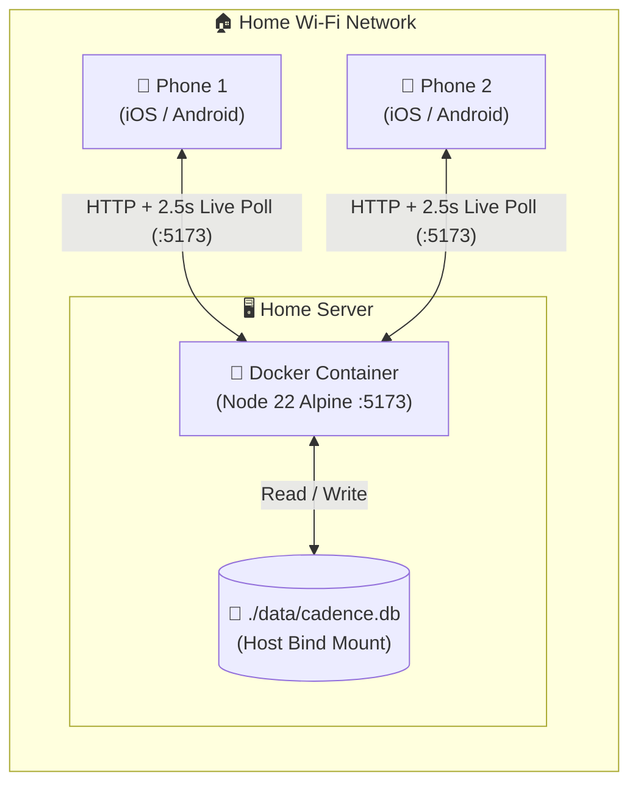

<div align="center">

# 🐾 Cadence

**A real-time, self-hosted household web app to track twice-daily pet medication and prevent accidental double-dosing.**

[](https://react.dev/)
[](https://vite.dev/)
[](https://tailwindcss.com/)
[](https://nodejs.org/api/sqlite.html)
[](https://www.docker.com/)

</div>

---

## 📖 Overview

When managing twice-daily pet medication across multiple caregivers, clear communication between household members is critical. **Cadence** is a 100% self-hosted, mobile-first dashboard designed to run in a single lightweight Docker container on a home server—storing all data locally in an embedded **SQLite** database while syncing checkmarks across every phone on your Wi-Fi network.

### ✨ Key Features

* 🛡️ **Anti-Double-Dose Status Banner:** High-visibility banner dynamically changes colour and messaging based on whether Morning, Evening, or both doses have been logged, alongside a live *"Time since last dose"* counter.
* ☀️🌙 **One-Tap Morning & Evening Cards:** Large, mobile-friendly buttons that log the exact timestamp, caregiver name, and optional administration notes (e.g., *"Given with wet food"*).
* 👥 **Caregiver Attribution:** Quickly switch between household members or pet sitters before logging a dose, with a confirmation safeguard before any completed dose can be unchecked.
* 🐾 **Customisable Pet & Medication Profile:** Configure your pet's name, medication name, prescribed dosage badge, target AM/PM schedule, and household care instructions directly from the UI.
* 💧 **Bottle Shelf-Life Tracker:** Tracks when the current medication bottle was opened and calculates remaining days against its open-bottle expiry limit.
* 📅 **Weekly History Browser & Adherence Score:** Browse any Monday–Sunday calendar week with Previous/Next week navigation or jump directly to any past date, with one-tap editing for retroactive or missed entries.
* 💾 **100% Local SQLite Storage & Live Sync:** Zero cloud dependencies or external accounts. Phones poll the local server every 2.5 seconds (and immediately on wake/focus) for live household updates.
* 🌙 **Dark Mode Support:** Built-in light and dark theme toggle with persistent local storage.

---

## 🏗️ Architecture

The application is compiled via a multi-stage Docker build and served by a zero-dependency **Node.js 22 Alpine** server (`server.js`) on port `5173`. Both the static React frontend and the REST API (`/api/state`, `/api/settings`, `/api/logs/:dateKey`) run inside the same container, backed by Node 22's built-in `node:sqlite` engine writing to a bind-mounted `./data/cadence.db` file on your host machine.



---

## 🖥️ Interface Preview

```text
+-----------------------------------------------------------------------+
| 🐱 Mochi's Oral Solution [2.5 mg / 0.5 ml]    [🌙 Dark] [⚙️ Settings] |
|    Tuesday 27 Oct • 🛜 Live Household Sync                            |
+-----------------------------------------------------------------------+
| 🛡️ AWAITING MORNING DOSE        🕒 Last dose: 5h 54m ago (Yesterday)  |
| ☀️ No Doses Logged Yet Today for Mochi                                |
|    Target schedule: Morning (08:00) & Evening (20:00)                 |
+-----------------------------------------------------------------------+
| 👤 WHO IS GIVING THE DOSE RIGHT NOW?                     + Add Person |
| [ • Partner 1 ]  [ • Partner 2 ]  [ • Pet Sitter ]                    |
+-----------------------------------+-----------------------------------+
| ☀️ Morning Dose  ~08:00 [PENDING] | 🌙 Evening Dose  ~20:00 [PENDING] |
| Dosage: 2.5 mg / 0.5 ml           | Dosage: 2.5 mg / 0.5 ml           |
| [ Add quick note (optional)...  ] | [ Add quick note (optional)...  ] |
|                                   |                                   |
| [  ✅ Check Morning (Partner 1) ] | [  ✅ Check Evening (Partner 1) ] |
+-----------------------------------+-----------------------------------+
| 💧 Oral Solution Tracker                  [🔄 Opened New Bottle Today]|
| [████████████░░░░░░░░░░░░░░░░░░░░░░░░░░] 142 days remaining           |
+-----------------------------------------------------------------------+
| 🕒 Medication History                  ✨ Week Adherence: 100% (4/4)  |
| [◀] 📅 Oct 26 – Nov 1, 2026 [THIS WEEK] [▶]   Jump to: [ 2026-10-27 ] |
| • Today (2026-10-27)      [☀️ AM • 08:02 Partner 1] [🌙 PM • Not logged]|
| • Yesterday (2026-10-26)  [☀️ AM • 08:05 Partner 2] [🌙 PM • 20:01 P1 ] |
+-----------------------------------------------------------------------+
```

---

## 🚀 Getting Started (Docker Deployment)

Running the tracker inside a Docker container is the recommended way to host the application cleanly on a home server without installing Node.js on the host machine. No external accounts or `.env` files are required.

### 1. Prerequisites
* [Docker Desktop](https://www.docker.com/products/docker-desktop/) (or Docker Engine) installed and running on your server.

### 2. Option A: Start with Docker Compose (Recommended)
Docker Compose automatically builds the image, maps port `5173`, and bind-mounts the `./data` folder on the host to `/app/data` inside the container:

```bash
docker compose up -d --build
```

### 3. Option B: Build & Run with `docker run`
If you prefer standalone Docker commands, pass `-v` to mount a local `data` folder so your SQLite database (`cadence.db`) lives on your host filesystem:

```powershell
# Build the multi-stage image
docker build -t cadence .

# Run in detached mode on port 5173 with persistent folder mount
docker run -d --name cadence -p 5173:80 -v "${PWD}/data:/app/data" --restart unless-stopped cadence
```

### 4. Portable Server Deployment (Optional)
If you build the image on a workstation and want to deploy it to a separate home server without copying source code:

```powershell
# 1. Export the built image on your build machine
docker save -o cadence.tar cadence

# 2. Copy cadence.tar to your server and load it
docker load -i cadence.tar

# 3. Start the container on the server with a persistent data folder
docker run -d --name cadence -p 5173:80 -v "C:\cadence-data:/app/data" --restart unless-stopped cadence
```

### 5. Upgrading the App Without Losing Data
Because the SQLite database (`cadence.db`) is stored in the bind-mounted host folder (`./data` or `C:\cadence-data`) **outside** the container image, you can freely rebuild or replace the container at any time without losing your settings or medication logs:

* **With Docker Compose:**
  ```bash
  docker compose up -d --build
  ```
* **With `docker run`:**
  ```powershell
  docker build -t cadence .
  docker rm -f cadence
  docker run -d --name cadence -p 5173:80 -v "${PWD}/data:/app/data" --restart unless-stopped cadence
  ```

### 6. Windows Server Firewall Rule
If hosting on Windows, allow inbound LAN traffic on port `5173` via an Administrator Command Prompt:

```cmd
netsh advfirewall firewall add rule name="Allow Cadence 5173" dir=in action=allow protocol=TCP localport=5173 profile=any
```

---

## 📱 Adding to Your Phone Home Screen

Once the container is running, find your server's local IP address (e.g., `192.168.1.50`) and open `http://192.168.1.50:5173` on your phone while connected to home Wi-Fi:

* **iOS (Safari):** Tap the **Share** button $\rightarrow$ **Add to Home Screen**.
* **Android (Chrome):** Tap the **Three-Dot Menu** $\rightarrow$ **Add to Home screen**.

---

## 🛠️ Local Development (Without Docker)

If you want to work on the UI locally using the Vite development server alongside the local SQLite API server:

```bash
# Install dependencies
npm install

# Terminal 1: Start the local SQLite backend on port 3001
PORT=3001 npm start

# Terminal 2: Start Vite dev server (proxies /api to localhost:3001)
npm run dev
```

---

## 📂 Project Structure

```text
cadence/
├── public/
│   └── favicon.svg         # App icon
├── src/
│   ├── App.jsx             # Main tracker UI & 2.5s local API polling logic
│   ├── index.css           # Tailwind v4 imports & dark mode overrides
│   └── main.jsx            # React entry point
├── data/                   # Persistent host folder containing cadence.db (auto-created)
├── server.js               # Node 22 HTTP + built-in SQLite static & REST API server
├── index.html              # App shell & theme toggle script
├── vite.config.js          # Vite, Tailwind v4 plugin & /api dev proxy config
├── Dockerfile              # Multi-stage Node 22 build + runtime image
├── docker-compose.yml      # Single-command container + ./data volume setup
├── .dockerignore           # Excludes host node_modules, dist, and local DB files
└── .gitignore              # Excludes build artifacts, .tar archives, and data/
```